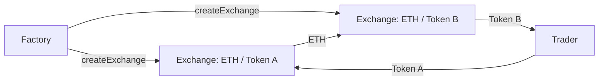

# ZoomV1

A decentralized exchange built on the Uniswap V1 design: a factory deploys one constant-product pool per token, liquidity providers earn swap fees, and any token can be swapped for any other through ETH.

## How it works



- **Factory.** `createExchange(token)` deploys an exchange for a token, one per token, and keeps the registry so exchanges can find each other.
- **Liquidity.** Each exchange holds ETH and one token. The first provider sets the price. Later deposits must match the current ratio, and providers receive `ZOOM` LP tokens for their share of the pool. Burning LP tokens returns ETH and tokens pro-rata, including accumulated fees.
- **Pricing.** Swaps follow the constant-product formula `x · y = k`, with a 1% fee that stays in the pool for liquidity providers. Large trades move the price, so every swap takes a minimum-output parameter to protect against slippage.
- **Swaps.** ETH → token, token → ETH, and token → token. A token-to-token swap sells into ETH on the first exchange, then buys the second token on its exchange through the factory, all in one transaction.

## Contracts

| File | |
|---|---|
| [`contracts/Factory.sol`](contracts/Factory.sol) | Deploys and registers one exchange per token |
| [`contracts/Exchange.sol`](contracts/Exchange.sol) | The pool: liquidity, LP tokens, pricing and all swap routes |
| [`contracts/Token.sol`](contracts/Token.sol) | ERC-20 used in the tests |

## Tests

25 Hardhat tests cover adding and removing liquidity, LP minting and burning, keeping the exchange rate on deposits, output amounts and pricing, fees paid to providers, slippage limits, and swaps in both directions between ETH and the token.

```bash
npm install
npx hardhat test
```

## Tech

Solidity · Hardhat · OpenZeppelin ERC-20 · ethers.js · Mocha and Chai
